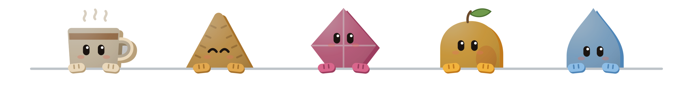

<p align="center">
  <picture>
    <source media="(prefers-color-scheme: dark)" srcset="./name-dark.png">
    <source media="(prefers-color-scheme: light)" srcset="./name-light.png">
    
  </picture>
</p>

<p align="center">
  
</p>

<p align="center">
  
</p>

```bash
$ whoami
hasnaat_malik

$ cat now.txt
building   AI tools people actually use
exploring  RAG, agents, evals
learning   Docker, Kubernetes, AWS
ask me     Rust, Tauri, Next.js
```

<p align="center">
  
</p>

<p align="center">
  <a href="https://hasnaatmalik.github.io/portfolio/">portfolio</a> ·
  <a href="https://linkedin.com/in/hasnaatmalik">linkedin</a> ·
  <a href="mailto:hasnaatmalik2003@gmail.com">email</a>
</p>
